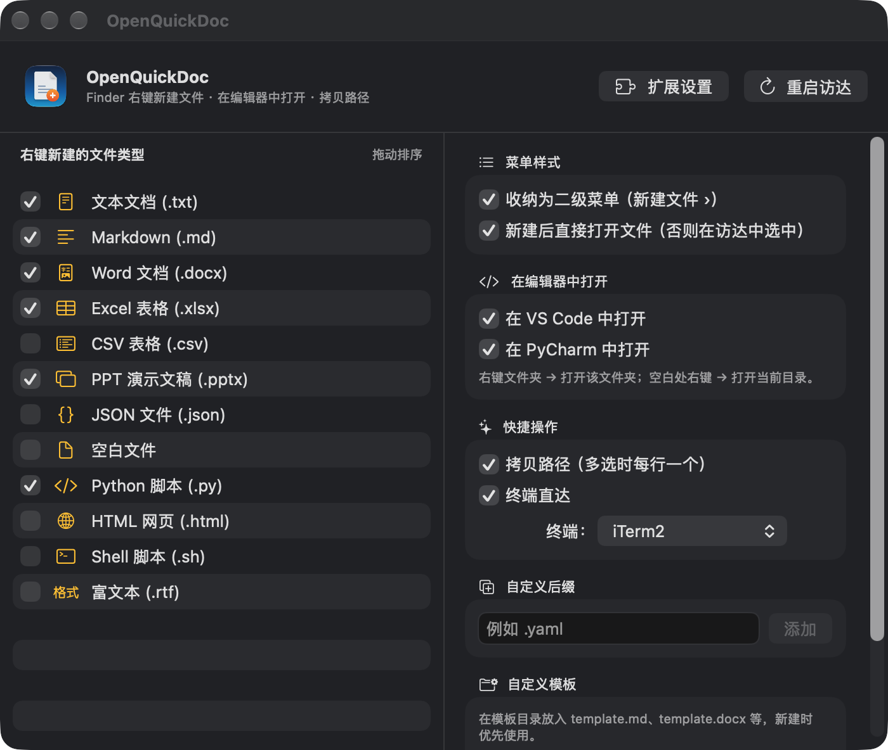

# OpenQuickDoc

macOS 访达（Finder）原生右键增强工具：快速新建各种文件、在 VS Code / PyCharm / iTerm2 中打开当前文件夹、复制路径。

纯 Swift + SwiftUI + FinderSync 原生实现，无 Electron，无驻留后台守护进程，内存占用极小。



## 功能特性

- **右键快速新建**：TXT、Markdown、Word（.docx）、Excel（.xlsx）、PowerPoint（.pptx）、Python、Shell、JSON、CSV、HTML、RTF、空白文件
- **合法的 Office 模板**：内置规范的 docx/xlsx/pptx 骨架，Office / WPS 打开不报错损坏
- **防重名自动递增**：`新建 Markdown 文件.md` → `新建 Markdown 文件 2.md`
- **支持自定义模板**：在 `~/Library/Application Support/OpenQuickDoc/Templates/` 放入 `template.md`、`template.py` 等，新建时自动优先使用
- **支持自定义扩展名**：设置面板可按需添加 `.yaml`、`.toml` 等任意后缀
- **类似 Windows 的快捷打开**：
  - 在 VS Code 中打开
  - 在 PyCharm 中打开
  - 在 iTerm2 / 终端中打开（自动执行 `cd` 切到当前目录）
  - 复制当前路径
- **右键二级菜单折叠**：可一键收纳进「新建文件 ›」，保持访达主菜单清爽
- **原生 SF Symbols 矢量图标**：完美自适应浅色/深色模式，高清不发虚

## 隐私与安全

- 不联网、不上传文件，也不收集遥测数据。
- 诊断日志默认关闭；如需排查问题，显式设置 `OPENQUICKDOC_DIAGNOSTICS=1` 后启动，日志不记录路径、文件名或错误详情。
- 自定义 URL Scheme 仅接受严格格式的本地绝对目录；收到外部请求时会先显示确认框，默认取消。
- 发布构建不包含 `get-task-allow` 调试权限。

## 构建与运行

系统要求：macOS 13.0+，需安装 Xcode Command Line Tools。

```bash
# 运行单元测试
./test.sh

# 编译并安装到 /Applications（自动签名并注册 Finder 扩展）
./build.sh --install

# 打包 DMG 安装包
./build.sh --dmg
```

## 首次使用设置

1. 打开 `/Applications/OpenQuickDoc.app`
2. 根据提示在 **系统设置 › 隐私与安全性 › 扩展 › 访达扩展** 中勾选 **OpenQuickDoc**
3. 使用 iTerm2 直达功能时，首次会请求控制 iTerm2 的自动化权限，点击「允许」即可

## 声明

本项目为独立重新实现的开源工具，代码完全重写，图标采用 Apple 官方 SF Symbols 矢量图形，内置 Office 模板使用 Python 脚本全新生成，不包含任何第三方私有素材。

## License

[MIT](LICENSE)
